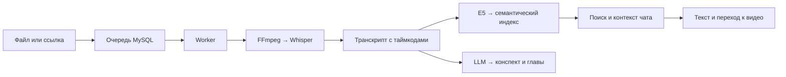

<div align="center">

# deepLecture

### Найдите нужную мысль в лекции — и сразу перейдите к ней в видео.

Семантический поиск · Транскрипты · Конспекты · Чат с источниками

**Киберрывок · Осень 2026 · Основной этап**

[Возможности](#возможности) · [Архитектура](#архитектура) · [Запуск](#запуск) · [Состояние проекта](#состояние-проекта)

</div>

---

## Зачем deepLecture

Нужное объяснение может занимать две минуты внутри полуторачасовой лекции.
Искать его вручную долго, а точные слова преподавателя обычно неизвестны.

deepLecture помогает искать **по смыслу**. Задайте вопрос вроде
«как найти расстояние по сторонам треугольника» — получите подходящие
фрагменты, их текст и переходы к соответствующим моментам видео.

## Возможности

| Возможность | Что делает сервис |
|---|---|
| Загрузка лекций | Принимает MP4 и WebM, сохраняет видео под уникальным ID |
| Импорт по ссылке | Ставит публичные видео YouTube и Vimeo в очередь загрузки |
| Транскрипция | Извлекает аудио и распознаёт речь с таймкодами |
| Семантический поиск | Ищет внутри лекции или по всем готовым индексам |
| Навигация | Возвращает текст фрагмента и ссылку на момент видео |
| Конспект и оглавление | Формирует краткое содержание и главы, привязанные к транскрипту |
| Чат по лекции | Подбирает контекст для LLM и проверяет ссылки на источники |
| Ключевые термины | Выделяет слова и фразы с упоминаниями в транскрипте |
| Локальные модели | Подготовлена конфигурация Whisper, E5 и Qwen3.5 4B |

Интерфейс включает каталог, плеер, транскрипт, поиск, конспект и чат.
Доступность результатов определяется готовностью соответствующего этапа:
ошибка конспекта не скрывает уже построенный поиск.

## Как это работает



Для глав модель возвращает ID существующих сегментов. Сервер проверяет их
и берёт время из транскрипта. Источники ответа чата также проходят проверку ID.
Эта проверка защищает привязки, но не гарантирует фактическую точность текста LLM.

## Архитектура

| Слой | Технологии |
|---|---|
| Интерфейс | HTML, CSS, Bootstrap 5, JavaScript |
| Публичный API | PHP 8.3, PDO MySQL |
| Поиск и чат | Python, FastAPI, NumPy |
| Обработка | Отдельный worker, очередь MySQL, heartbeat и lease |
| Видео и аудио | FFmpeg, ffprobe, yt-dlp, Deno |
| Распознавание | faster-whisper |
| Эмбеддинги | intfloat/multilingual-e5-small, 384 компонента |
| Конспекты и ответы | OpenAI-compatible API; локально Ollama + Qwen3.5 4B |
| Хранение и запуск | MySQL 8.4, файловые volumes, Nginx, PHP-FPM, Docker Compose |

Браузер обращается к PHP API. Внутренний FastAPI и LLM не публикуются напрямую.
Долгие операции выполняет worker; устаревшее задание не может опубликовать
результат после потери lease.

## Ветки и документация

Компоненты разрабатываются отдельно. **Наличие этого README в dev не означает,
что реализации уже объединены в этой ветке.**

| Ветка | Содержимое |
|---|---|
| `dev` | Общая документация и интеграция команды |
| `backend` | PHP/Python API, worker, инфраструктура, инструкции и тесты |
| `frontend` | Веб-интерфейс |
| `repository_sql` | Production-миграции, seeds и проверки БД |

- [Архитектура проекта](architecture/architecture.md)
- [HTTP-контракт](contracts/http-api.md)
- [Контракт хранения](contracts/database.md)
- [Запуск backend](https://github.com/NightWolfXCore/deepLecture/blob/backend/backend/README.md)
- [Подключение frontend](https://github.com/NightWolfXCore/deepLecture/blob/backend/backend/FRONTEND.md)
- [Настройка LLM](https://github.com/NightWolfXCore/deepLecture/blob/backend/backend/LLM.md)
- [Локальный GGUF на Windows / PowerShell](https://github.com/NightWolfXCore/deepLecture/blob/backend/backend/GGUF-WINDOWS.md)
- [Результаты проверок](https://github.com/NightWolfXCore/deepLecture/blob/backend/tests/backend/VALIDATION.md)

Контракты в отдельных ветках могут обновляться в разное время. При интеграции
используйте актуальные версии вместе с соответствующим кодом.

## Запуск

Пока ветки не объединены, инструкции запуска находятся в `backend`.
Для Docker-сценария нужен запущенный Docker Desktop с Linux containers
или Docker Engine с Compose v2. Команды подготовки для Windows PowerShell:

```powershell
git clone https://github.com/NightWolfXCore/deepLecture.git
Set-Location deepLecture
git switch backend

if (-not (Test-Path .env)) {
    Copy-Item .env.example .env
}
```

Далее по [инструкции backend](https://github.com/NightWolfXCore/deepLecture/blob/backend/backend/README.md):

1. Настройте переменные окружения. Общий Compose требует непустой `DB_PASSWORD`;
   существующий пароль автоматически не назначается и не угадывается.
2. Соберите образы и примените миграции участника БД к подготовленной MySQL.
3. Подготовьте веса Whisper/E5 и выберите внешний либо локальный LLM.
4. Подключите checkout фронтенда через предусмотренный Compose override.
5. Запустите сервисы и проверьте `/api/v1/health` и `/api/v1/ready`.

Ollama отдельно устанавливать на Windows не нужно при использовании её
Docker-сервиса. Образ сервера и веса модели загружаются отдельно. Скачанный
GGUF можно импортировать через Modelfile; исходный файл хранится в
`storage/llm/`, вне Git. Подробности — в инструкции PowerShell выше.

Секреты, загруженные видео и веса моделей не коммитятся. Для текущего MVP
предусмотрена закрытая демонстрация без пользовательской авторизации.

## API

Публичный адрес при стандартном Docker-запуске: `http://localhost:8080/api/v1`.
Успешный JSON-ответ содержит `data`, списки могут дополнительно содержать `meta`.
Ошибки содержат `error.code`, `error.message`, `error.details` и `request_id`.
ID лекций — UUID, таймкоды — целые миллисекунды.

| Метод | Маршрут относительно `/api/v1` | Назначение |
|---|---|---|
| GET | `/health` | Проверить PHP API |
| GET | `/ready` | Проверить БД и готовность поиска |
| POST | `/lectures` | Загрузить MP4/WebM: multipart-поля `title`, `file` |
| POST | `/lectures/import` | Импортировать ссылку: JSON `title`, `url` |
| GET | `/lectures?page=1&per_page=20` | Получить каталог |
| GET | `/lectures/{id}` | Получить карточку, статус и доступность результатов |
| GET | `/lectures/{id}/transcript` | Получить сегменты транскрипта с таймкодами |
| POST | `/search` | Искать по смыслу: `query`, необязательные `lecture_id`, `limit` |
| GET | `/lectures/{id}/summary` | Получить конспект и главы |
| GET | `/lectures/{id}/terms` | Получить термины и их упоминания |
| POST | `/lectures/{id}/chat` | Задать вопрос: `question`, необязательный `history` |
| POST | `/lectures/{id}/retry` | Повторить обработку лекции в состоянии failed |

Видео обслуживается отдельно: `GET/HEAD /media/videos/{имя-файла}` с поддержкой
Range. Используйте возвращённый `media_url`; ссылка `playback_url` из поиска
ведёт на интерфейс с параметрами лекции и времени.

Примеры для **PowerShell** после запуска сервисов:

```powershell
Invoke-RestMethod http://localhost:8080/api/v1/health
Invoke-RestMethod http://localhost:8080/api/v1/ready

# Поиск по всем готовым лекциям:
$body = @{ query = 'Как связаны стороны треугольника?'; limit = 5 } | ConvertTo-Json
Invoke-RestMethod -Method Post -Uri http://localhost:8080/api/v1/search -ContentType 'application/json; charset=utf-8' -Body ([System.Text.Encoding]::UTF8.GetBytes($body))

# Загрузка файла; укажите существующий путь. curl.exe используется явно,
# поскольку в Windows PowerShell имя curl может быть псевдонимом другой команды.
curl.exe -F 'title=Демонстрационная лекция' -F 'file=@C:/Videos/lecture.mp4' http://localhost:8080/api/v1/lectures
```

Загрузка и импорт возвращают `202 Accepted`: задание поставлено в очередь.
Опросите `/lectures/{id}` до завершения нужного этапа. До готовности ресурсы
могут возвращать 409; ошибки конспекта не обязательно делают поиск недоступным.

Полные тела запросов, ответы, лимиты и коды ошибок:
[актуальный HTTP-контракт backend](https://github.com/NightWolfXCore/deepLecture/blob/backend/contracts/http-api.md).
FastAPI `/internal/v1/*` предназначен для PHP и не является публичным API.

## Состояние проекта

Последний локальный срез проверки новых API: **121 Python/HTTP-тест и
29 PHP-проверок**. Проверена работа со схемой из `repository_sql`, включая
повторный запуск мигратора и проверки владельца БД.

Эти тесты использовали настоящие MySQL, PHP-FPM, Nginx, FastAPI и FFmpeg,
но явные подмены ASR, эмбеддингов, LLM и сетевого источника загрузчика.
Они подтверждают протоколы и обработку данных, а не качество моделей.

Пока не подтверждены реальное скачивание с YouTube/Vimeo, inference
Whisper/E5/Qwen, точность попадания ASR в речь, полный браузерный сценарий
и работа всего приложения без интернета. Новый production-образ после
добавления зависимостей импорта требует сборки и проверки.

## Планы развития

- Провести демонстрацию на настоящих русскоязычных лекциях и оценить релевантность поиска.
- Измерить скорость обработки и точность таймкодов на целевом оборудовании.
- Проверить импорт на реальных публичных видео обеих платформ.
- Подготовить полностью локальные ресурсы интерфейса и проверить офлайн-сценарий.
- Добавить управление курсами, авторизацию и более точное выделение терминов.

## Лицензия

Проект распространяется на условиях [LICENSE](LICENSE).
