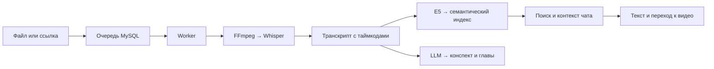

<div align="center">

# deepLecture

### Найдите нужную мысль в лекции — и сразу перейдите к ней в видео.

Семантический поиск · Транскрипты · Конспекты · Чат с источниками

**Киберрывок · Осень 2026 · Основной этап**

[Возможности](#возможности) · [Архитектура](#архитектура) · [Запуск](#запуск) · [Состояние проекта](#состояние-проекта)

</div>

---

## Зачем deepLecture

Нужное объяснение может занимать две минуты внутри полуторачасовой лекции.
Искать его вручную долго, а точные слова преподавателя обычно неизвестны.

deepLecture помогает искать **по смыслу**. Задайте вопрос вроде
«как найти расстояние по сторонам треугольника» — получите подходящие
фрагменты, их текст и переходы к соответствующим моментам видео.

## Возможности

| Возможность | Что делает сервис |
|---|---|
| Загрузка лекций | Принимает MP4 и WebM, сохраняет видео под уникальным ID |
| Импорт по ссылке | Ставит публичные видео YouTube и Vimeo в очередь загрузки |
| Транскрипция | Извлекает аудио и распознаёт речь с таймкодами |
| Семантический поиск | Ищет внутри лекции или по всем готовым индексам |
| Навигация | Возвращает текст фрагмента и ссылку на момент видео |
| Конспект и оглавление | Формирует краткое содержание и главы, привязанные к транскрипту |
| Чат по лекции | Подбирает контекст для LLM и проверяет ссылки на источники |
| Ключевые термины | Выделяет слова и фразы с упоминаниями в транскрипте |
| Локальные модели | Подготовлена конфигурация Whisper, E5 и Qwen3 4B |

Интерфейс включает каталог, плеер, транскрипт, поиск, конспект и чат.
Доступность результатов определяется готовностью соответствующего этапа:
ошибка конспекта не скрывает уже построенный поиск.

## Как это работает



Для глав модель возвращает ID существующих сегментов. Сервер проверяет их
и берёт время из транскрипта. Источники ответа чата также проходят проверку ID.
Эта проверка защищает привязки, но не гарантирует фактическую точность текста LLM.

## Архитектура

| Слой | Технологии |
|---|---|
| Интерфейс | HTML, CSS, Bootstrap 5, JavaScript |
| Публичный API | PHP 8.3, PDO MySQL |
| Поиск и чат | Python, FastAPI, NumPy |
| Обработка | Отдельный worker, очередь MySQL, heartbeat и lease |
| Видео и аудио | FFmpeg, ffprobe, yt-dlp, Deno |
| Распознавание | faster-whisper |
| Эмбеддинги | intfloat/multilingual-e5-small, 384 компонента |
| Конспекты и ответы | OpenAI-compatible API; локально Ollama + Qwen3 4B |
| Хранение и запуск | MySQL 8.4, файловые volumes, Nginx, PHP-FPM, Docker Compose |

Браузер обращается к PHP API. Внутренний FastAPI и LLM не публикуются напрямую.
Долгие операции выполняет worker; устаревшее задание не может опубликовать
результат после потери lease.

## Ветки и документация

В `dev` объединены backend, frontend и production-миграции MySQL.
`main` содержит интегрированный вариант для демонстрации; тесты остаются в
ветках разработки. Ветки компонентов сохраняются для дальнейшей работы.

- [Архитектура проекта](architecture/architecture.md)
- [HTTP API: запросы, ответы и ошибки](contracts/http-api.md)
- [Контракт хранения](contracts/database.md)
- [Настройка LLM и офлайн-режима](backend/LLM.md)
- [Состояние и ограничения проверки](backend/STATUS.md)

## Запуск

Нужны запущенный Docker Desktop с **Linux containers** или Docker Engine,
Docker Compose v2 и Git. Ollama отдельно устанавливать не нужно: она запускается
контейнером. Команды ниже одинаковы для терминалов Windows, Linux и macOS.
Выполняйте их из корня репозитория.

### 1. Получить проект и подготовить конфигурацию

```text
git clone --branch main https://github.com/NightWolfXCore/deepLecture.git
cd deepLecture
```

Для существующего checkout сохраните свои изменения, затем:

```text
git fetch origin
git switch main
git pull --ff-only origin main
```

`.env` создаётся **автоматически** при `up -d mysql ollama`, если его ещё нет.
По умолчанию локальная MySQL использует `root` с **пустым паролем** только
внутри Docker-сети, без публикации порта БД. От вас требуется только GGUF.
Существующий `.env` сохраняется. Локальный Compose явно задаёт пустой пароль
и параметры Qwen3, поэтому вручную менять конфигурацию не требуется.
Проект называется `deeplecture-demo` и использует собственные volumes.

Создайте папку **`storage/llm`** и положите туда полный файл **Qwen3 4B Q4 GGUF**
под именем **`Qwen3-4B-Q4_K_M.gguf`**. Итоговый путь от корня: `storage/llm/Qwen3-4B-Q4_K_M.gguf`.
Не используйте `mmproj`, адаптер или одну часть разделённой модели.
Q4_K_M подходит. Импорт сохраняет квантизацию исходного файла.
Файл GGUF, видео и секреты не коммитятся и не включаются в build-контекст.

Все подключения и имя импортируемой модели уже заданы в корневом
`compose.yaml`. `.env.llm`, дополнительные `-f` и ручная настройка не нужны.

### 2. Собрать образы, применить миграции и подготовить модели

```text
docker compose config --quiet
docker compose build php search
docker compose up -d mysql ollama
docker compose run --rm migrate
docker compose exec ollama ollama create Qwen3-4B-Q4_K_M -f /config/Modelfile
docker compose exec ollama ollama show Qwen3-4B-Q4_K_M
docker compose run --rm --no-deps worker python -m app.prepare_models
docker compose run --rm --no-deps worker python -m app.check_llm
```

Выполняйте команды последовательно; при ошибке сначала исправьте её.
`php` и `search` собирают PHP и общий Python-образ, используемый также worker
и мигратором. При обычном `docker compose up -d` сервис `migrate` запускается автоматически;
PHP, search и worker ждут его успешного завершения. При ошибке миграции запуск
зависимых сервисов блокируется, а причина остаётся в `docker compose logs migrate`.
Ручной запуск выше также поддерживается.

`migrate` ждёт готовности MySQL и применяет **production-миграции
из `migrations/`**. Повторный запуск безопасен; тестовые seeds не нужны.
Уже применённые SQL-файлы изменять нельзя.

При старте контейнер Ollama автоматически импортирует GGUF под именем
`Qwen3-4B-Q4_K_M`; healthcheck проверяет наличие именно этой модели.
Команда `ollama create` выше остаётся доступна для явного повторного импорта. `ollama show` показывает реальный тип
квантизации: убедитесь, что это Q4 и нужная модель Qwen3 4B.
`prepare_models` отдельно загружает настоящие Whisper и E5; GGUF их не заменяет.
Первая сборка и загрузка весов требуют интернета, места на диске и могут занять
значительное время. Нужна RAM для Whisper, E5 и Qwen одновременно.
`check_llm` делает настоящий запрос к Qwen и проверяет JSON-ответ.

### 3. Запустить приложение

```text
docker compose up -d
docker compose ps
```

Откройте **http://localhost:8080**. Отдельный сервер frontend не нужен.
Bootstrap поставляется локально; внешний CDN интерфейсу не требуется.
Проверки в браузере:

- http://localhost:8080/api/v1/health — PHP API;
- http://localhost:8080/api/v1/ready — соединение с MySQL и готовность поиска.

После старта E5 может загружаться некоторое время. Готовность LLM проверяется
отдельной командой `check_llm`. Загрузите короткое MP4/WebM с речью, дождитесь
обработки и проверьте поиск, перемотку, транскрипт, конспект и чат.
Импорт YouTube/Vimeo требует доступа к платформам/CDN; приватные видео,
cookies и DRM не поддерживаются. Скорость реальной обработки на CPU не измерена.

### Управление и диагностика

```text
docker compose logs --tail 100 worker search nginx
docker compose run --rm migrate python /app/migrate.py --status
docker compose restart worker search
docker compose stop
docker compose up -d
docker compose down
```

`stop` останавливает контейнеры; `up -d` запускает их; `down` удаляет контейнеры
и сеть, сохраняя данные. **Не используйте `down -v`: он удалит БД, видео и веса.**
Данные сохраняются в volumes `mysql-data`, `storage`, `models`, `ollama-models`.
Исходный GGUF остаётся в `storage/llm`, импорт — в volume Ollama.

Если storage volume создан старой версией приложения, один раз подготовьте
каталоги следующей командой перед запуском worker:

```text
docker compose run --rm --no-deps --user root php sh -c 'mkdir -p /data/imports /data/downloads; chown 33:33 /data/videos /data/imports; chown 1000:1000 /data/downloads; chmod 2775 /data/videos; chmod 755 /data/imports /data/downloads'
```

MVP доступен только на localhost и не имеет пользовательской авторизации.
Для внешнего доступа нужен защищённый reverse proxy. Дополнительные варианты
с внешним LLM и офлайн-сетью: [LLM.md](backend/LLM.md).

## API

Публичный адрес при стандартном Docker-запуске: `http://localhost:8080/api/v1`.
Успешный JSON-ответ содержит `data`, списки могут дополнительно содержать `meta`.
Ошибки содержат `error.code`, `error.message`, `error.details` и `request_id`.
ID лекций — UUID, таймкоды — целые миллисекунды.

| Метод | Маршрут относительно `/api/v1` | Назначение |
|---|---|---|
| GET | `/health` | Проверить PHP API |
| GET | `/ready` | Проверить БД и готовность поиска |
| POST | `/lectures` | Загрузить MP4/WebM: multipart-поля `title`, `file` |
| POST | `/lectures/import` | Импортировать ссылку: JSON `title`, `url` |
| GET | `/lectures?page=1&per_page=20` | Получить каталог |
| GET | `/lectures/{id}` | Получить карточку, статус и доступность результатов |
| GET | `/lectures/{id}/transcript` | Получить сегменты транскрипта с таймкодами |
| POST | `/search` | Искать по смыслу: `query`, необязательные `lecture_id`, `limit` |
| GET | `/lectures/{id}/summary` | Получить конспект и главы |
| GET | `/lectures/{id}/terms` | Получить термины и их упоминания |
| POST | `/lectures/{id}/chat` | Задать вопрос: `question`, необязательный `history` |
| POST | `/lectures/{id}/retry` | Повторить обработку лекции в состоянии failed |

Видео обслуживается отдельно: `GET/HEAD /media/videos/{имя-файла}` с поддержкой
Range. Используйте возвращённый `media_url`; ссылка `playback_url` из поиска
ведёт на интерфейс с параметрами лекции и времени.

Пример JSON для `POST /api/v1/search` (Postman или любой HTTP-клиент):

```json
{"query":"Как связаны стороны треугольника?","limit":5}
```

Чтобы искать внутри одной лекции, добавьте `"lecture_id":"UUID_ЛЕКЦИИ"`.
Загрузка `POST /lectures` использует multipart form-data с `title` и `file`.
Импорт `POST /lectures/import` использует JSON:

```json
{"title":"Моя лекция","url":"https://www.youtube.com/watch?v=VIDEO_ID"}
```

Загрузка и импорт возвращают `202 Accepted`: задание поставлено в очередь.
Опросите `/lectures/{id}` до завершения нужного этапа. До готовности ресурсы
могут возвращать 409; ошибки конспекта не обязательно делают поиск недоступным.

Полные тела запросов, ответы, лимиты и коды ошибок:
[HTTP-контракт](contracts/http-api.md).
FastAPI `/internal/v1/*` предназначен для PHP и не является публичным API.

## Состояние проекта

Последний локальный срез проверки новых API: **121 Python/HTTP-тест и
29 PHP-проверок**. Проверена работа со схемой из `repository_sql`, включая
повторный запуск мигратора и проверки владельца БД.

Эти тесты использовали настоящие MySQL, PHP-FPM, Nginx, FastAPI и FFmpeg,
но явные подмены ASR, эмбеддингов, LLM и сетевого источника загрузчика.
Они подтверждают протоколы и обработку данных, а не качество моделей.

Пока не подтверждены реальное скачивание с YouTube/Vimeo, inference
Whisper/E5/Qwen, точность попадания ASR в речь
и работа всего приложения без интернета. Браузерный сценарий поиска, видео,
субтитров, терминов и чата прошёл на явно подготовленных тестовых данных. Результат финальной интеграционной
проверки записан в [отчёте](backend/RELEASE.md).

## Планы развития

- Провести демонстрацию на настоящих русскоязычных лекциях и оценить релевантность поиска.
- Измерить скорость обработки и точность таймкодов на целевом оборудовании.
- Проверить импорт на реальных публичных видео обеих платформ.
- Подготовить полностью локальные ресурсы интерфейса и проверить офлайн-сценарий.
- Добавить управление курсами, авторизацию и более точное выделение терминов.

## Лицензия

Проект распространяется на условиях [LICENSE](LICENSE).

## Восстановление после ошибки отсутствующих таблиц

Если в логах есть MySQL 1146 (`Table ... doesn't exist`), выполните:

```text
docker compose run --rm migrate
docker compose run --rm migrate python /app/migrate.py --status
docker compose restart php search worker
```

Ожидается `[x] 001_initial_schema.sql`. Данные и модели удалять не нужно.
Для разработки исправления находятся в `dev`; `main` содержит только релизы.
Логи: `docker compose logs --no-color --tail 100 php search worker migrate mysql ollama`.

Если Ollama возвращает HTTP 404 при создании конспекта, проверьте имя модели:

```text
docker compose exec ollama ollama create Qwen3-4B-Q4_K_M -f /config/Modelfile
docker compose exec ollama ollama show Qwen3-4B-Q4_K_M
docker compose run --rm --no-deps worker python -m app.check_llm
```

После обновления автоматического импорта пересоздайте Ollama:
`docker compose up -d --force-recreate ollama`.

## Учебные конспекты и каталог

Вкладка **«Каталог лекций»** открывает отдельную страницу с фильтром по предметам.
Предмет выбирается при загрузке; его можно изменить на странице существующей
лекции. Старые записи получают категорию «Другое».

Новый конспект раскрывает определения, формулы, условия применения и разбор
примеров из транскрипта. Он отображается по разделам. Кнопка **«Скачать конспект
.docx»** выгружает документ с оформлением и оглавлением с таймкодами. Старые
конспекты доступны для экспорта, но автоматически не переписываются.

**«Создать конспект заново»** повторяет только работу LLM по готовому транскрипту.
Это доступно через **24 часа после последней успешной генерации**. Время
разблокировки отображается на странице; сервер также проверяет ограничение.
Видеофайл, транскрипт и поисковый индекс при этом сохраняются.
Предупреждение о возможных ошибках ИИ находится на страницах лекций, в общем
подвале и в экспортируемом документе. Формулы и выводы необходимо проверять.

Обновление существующего запуска из dev, без удаления данных:

```text
git switch dev
git pull --ff-only origin dev
docker compose build php search
docker compose run --rm migrate
docker compose up -d
```

Миграции 002/003 добавляют предметы и время успешной генерации; конфигурацию
вручную менять не нужно. Обновите страницу браузера с Ctrl+F5.

Если возникла ошибка «В JSON-ответе LLM нет текста конспекта или списка глав»,
обновите `dev`, пересоберите Python-образ и пересоздайте сервисы:

```text
git switch dev
git pull --ff-only origin dev
docker compose build search
docker compose up -d search worker
docker compose run --rm --no-deps worker python -m app.check_llm
```

Локальный Qwen теперь получает строгую JSON-схему автоматически, без ручной
правки `.env`. После `LLM smoke OK` нажмите **«Повторить создание конспекта»**:
видео и транскрипт обрабатываться заново не будут.


На CPU конспект может формироваться дольше распознавания: в пользовательском
логе Qwen3 4B Q4 генерирует около 4 токенов/с. При такой скорости 3000 токенов —
примерно 12,5 минуты плюс обработка входа. Для локального режима установлен
таймаут 20 минут на запрос; запрос не отправляется повторно после таймаута
ожидания ответа. Это изменение исправляет повторную работу, а не скорость CPU.
Следите за частями конспекта: `docker compose logs -f worker`.
Потребление ресурсов: `docker compose stats --no-stream`.
