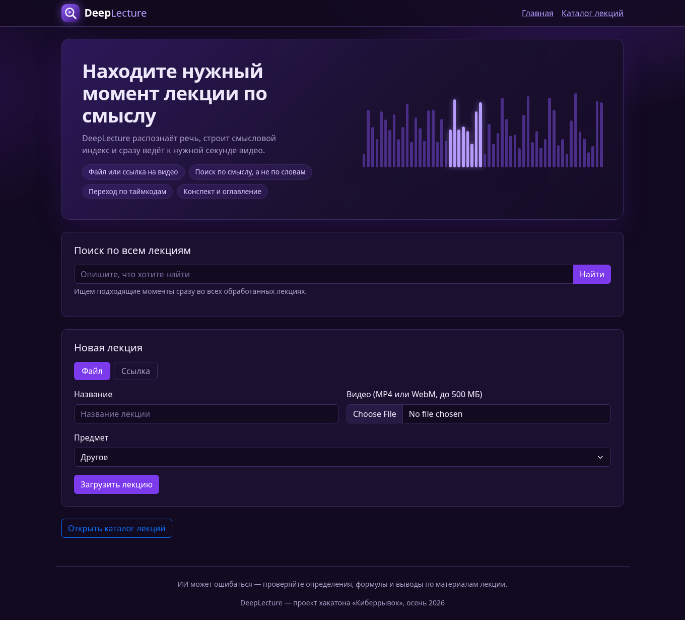
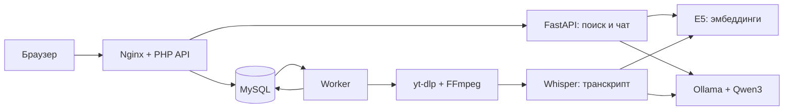

<div align="center">


# deepLecture

### Найдите нужную мысль. Откройте нужную минуту. Разберитесь в теме.

Семантический поиск по видеолекциям · Учебные конспекты · Локальный ИИ


[](LICENSE)

**Киберрывок · Осень 2026 · Основной этап**

[Возможности](#возможности) · [Запуск](#запуск) · [Обновление](#обновление) · [API](#api) · [Документация](#документация)

</div>

---

> **Перед запуском нужен один файл:** `Qwen3-4B-Q4_K_M.gguf` в папке `storage/llm/`.
> Веса модели не входят в Git-репозиторий. Ollama, конфигурация и миграции запускаются через Docker Compose.

## Зачем deepLecture

Нужное объяснение может занимать две минуты внутри длинной лекции. Точные слова
преподавателя легко забыть — смысл вопроса остаётся.

deepLecture принимает запрос на обычном языке, находит подходящие фрагменты
и открывает видео с нужного момента. Транскрипт, оглавление и учебный конспект
помогают повторить материал, а чат отвечает по содержанию выбранной лекции.

<div align="center">

<br>
<sub>Скриншот работающего веб-интерфейса.</sub>
</div>

## Возможности

| | Возможность | Что получает пользователь |
|---|---|---|
| 🎬 | Видео и ссылки | MP4/WebM или публичное видео YouTube/Vimeo |
| 📚 | Каталог по предметам | Математика, русский язык, физика и другие категории; фильтрация и смена предмета |
| 🔎 | Поиск по смыслу | Фрагменты внутри одной лекции или по всей библиотеке, текст и таймкоды |
| ▶️ | Удобная навигация | Встроенный плеер, синхронный транскрипт, переходы по тексту и главам |
| 📝 | Учебный конспект | Определения, формулы, условия применения и разбор примеров из транскрипта |
| 📄 | Экспорт в Word | `.docx` с заголовками, выделениями, списками и оглавлением с таймкодами |
| 💬 | Вопросы по лекции | Ответы с проверяемыми ссылками на исходные фрагменты |
| 🏷️ | Ключевые термины | Упоминания, подсветка и переходы к соответствующим местам |
| 🔄 | Новый конспект | Повторная генерация без повторного скачивания, распознавания и индексации |
| 🖥️ | Локальные модели | Whisper, multilingual-e5 и Qwen3 4B через Ollama; платный API для стандартного запуска не нужен |

**Повторный конспект доступен через 24 часа после последней успешной генерации.**
Ограничение проверяет сервер, а страница показывает время разблокировки.
Неуспешная генерация не сдвигает время последнего успеха. Если конспект не
создан, готовые транскрипт и поиск остаются доступны.

> ИИ может ошибаться. Проверяйте определения, формулы и выводы по материалам лекции.
> Предупреждение размещено в интерфейсе и экспортируемом документе.

## Запуск

### 1. Получить проект

Нужны Git и запущенный **Docker Desktop с Linux containers** либо Docker Engine
с **Docker Compose v2**. Команды выполняются из корня проекта в обычном терминале.
Отдельно устанавливать PHP, Python, MySQL, FFmpeg и Ollama на компьютер не нужно.

```text
git clone --branch main https://github.com/NightWolfXCore/deepLecture.git
cd deepLecture
```

### 2. Добавить модель

Скачайте **Qwen3 4B в квантизации Q4_K_M, формат GGUF**:
[репозиторий модели](https://huggingface.co/Qwen/Qwen3-4B-GGUF) ·
[файл Qwen3-4B-Q4_K_M.gguf](https://huggingface.co/Qwen/Qwen3-4B-GGUF/resolve/main/Qwen3-4B-Q4_K_M.gguf?download=true).

Создайте папку в файловом менеджере и поместите туда **полный файл весов**:

```text
 deepLecture/
 ├── compose.yaml
 └── storage/
     └── llm/
         └── Qwen3-4B-Q4_K_M.gguf
```

Имя и регистр должны совпадать. Файл `mmproj`, адаптер или одна часть split-модели
не заменяют полный GGUF. Веса исключены из Git и Docker build-контекста.

**Вручную редактировать конфигурацию не нужно.** Корневой Compose задаёт имя
`Qwen3-4B-Q4_K_M` и подключения. `.env` создаётся автоматически, если его нет;
существующий файл сохраняется. Для этого сценария не нужны `.env.llm` и дополнительные `-f`.

### 3. Собрать и подготовить сервисы

Выполняйте команды последовательно. При ошибке сначала устраните её, затем продолжайте.

```text
docker compose config --quiet
docker compose build php search
docker compose up -d --wait mysql ollama
docker compose run --rm migrate
docker compose exec ollama ollama show Qwen3-4B-Q4_K_M
docker compose run --rm --no-deps worker python -m app.prepare_models
docker compose run --rm --no-deps worker python -m app.check_llm
```

| Команда / сервис | Что происходит |
|---|---|
| `build php search` | Собираются PHP и общий Python-образ для поиска, worker и мигратора |
| `up … mysql ollama` | Создаётся `.env`, запускается БД, GGUF автоматически импортируется в Ollama |
| `run --rm migrate` | Применяются production-миграции из `migrations/`; повторный запуск безопасен |
| `ollama show` | Проверяются наличие модели и её метаданные |
| `app.prepare_models` | Скачиваются и загружаются отдельные модели Whisper и E5 |
| `app.check_llm` | Выполняется настоящий запрос к Qwen и проверяются структура конспекта и ID глав |

Перед продолжением ожидайте **`LLM smoke OK`**. GGUF Qwen не заменяет Whisper/E5.
Первая сборка, загрузка образов и весов требуют интернета, времени и свободного
места на диске. После подготовки веса сохраняются в Docker volumes.

### 4. Открыть приложение

```text
docker compose up -d
docker compose ps -a
```

**Приложение: [http://localhost:8080](http://localhost:8080)**

| Проверка | Адрес / ожидаемый результат |
|---|---|
| PHP API | `http://localhost:8080/api/v1/health` → `data.status: ok` |
| БД и поиск | `http://localhost:8080/api/v1/ready` → `data.status: ok` |
| Миграции | Сервис `migrate` завершился с кодом 0 |
| Конфигурация | Сервис `init-env` завершился с кодом 0 — это нормально |

При `up` мигратор также запускается автоматически. PHP, search и worker
ожидают его успешного завершения. Справочная тестовая схема и seeds для запуска
не нужны. Фронтенд обслуживает тот же Nginx; Bootstrap хранится локально.

**Первый сценарий:** выберите предмет → загрузите короткое видео с речью →
дождитесь готовности транскрипта и поиска → найдите фрагмент → откройте конспект
и скачайте `.docx`. Для YouTube/Vimeo нужен доступ к платформам и их CDN;
приватные видео, cookies и DRM не поддерживаются.

### Время работы на CPU

В пользовательском запуске Qwen3 4B Q4 выдавал около **4 токенов/с**, занимал
около **5,4 ГиБ RAM** и использовал примерно восемь логических ядер. Это
наблюдение на одном компьютере, а не универсальная оценка требований.
Учитывайте также память остальных сервисов и моделей.

3000 выходных токенов при такой скорости — около **12,5 минуты**, плюс обработка
входного текста. Короткий ответ может завершиться раньше. Локальный лимит
ожидания — **20 минут на запрос**; для нескольких частей и объединения общее
время может быть больше. Уже отправленная генерация не запускается повторно
после таймаута ожидания ответа.

```text
docker compose logs -f worker
docker compose stats --no-stream
docker compose exec ollama ollama ps
```

Не запускайте параллельный `check_llm`, пока worker создаёт конспект: локальная
Ollama обрабатывает один запрос одновременно. Логи worker показывают части
конспекта, время ответа и число выходных токенов, если сервер их сообщил.

## Обновление

Для уже установленного приложения сохраните свои изменения в Git и обновите релиз:

```text
git fetch origin
git switch main
git pull --ff-only origin main
docker compose build php search
docker compose run --rm migrate
docker compose up -d
```

Затем обновите страницу с **Ctrl+F5**. `.env`, видео и Docker volumes не удаляются.
Старые лекции получают категорию «Другое» — её можно изменить на странице лекции.
Ранее сохранённые конспекты автоматически не переписываются; новая генерация
доступна по кнопке после окончания 24-часового ограничения.

Обновление worker может прервать его текущую попытку. Очередь восстанавливает
задание после истечения lease; готовые транскрипт и индекс используются при
повторе этапа конспекта.

## Управление и хранение

| Действие | Команда |
|---|---|
| Статус всех сервисов | `docker compose ps -a` |
| Последние логи | `docker compose logs --no-color --tail 100 php search worker migrate mysql ollama` |
| Состояние миграций | `docker compose run --rm migrate python /app/migrate.py --status` |
| Остановить | `docker compose stop` |
| Запустить снова | `docker compose up -d` |
| Удалить контейнеры и сеть, сохранив данные | `docker compose down` |

**Не используйте `docker compose down -v`, если хотите сохранить данные:**
флаг `-v` удаляет volumes с БД, видео и моделями.

| Хранилище | Содержимое |
|---|---|
| `mysql-data` | База данных, очередь и результаты обработки |
| `storage` | Видео, приватные источники импорта и рабочие файлы |
| `models` | Кэш Whisper и E5 |
| `ollama-models` | Импортированные веса Ollama |
| `storage/llm/` на компьютере | Исходный GGUF пользователя |

Проект Compose называется `deeplecture-demo`; имена volumes получают этот
префикс. Для резервной копии сохраняйте БД и файловое хранилище согласованно.
Модели и образы также нужны при переносе на компьютер без интернета.

<details>
<summary><b>Настройки стандартного локального запуска</b></summary>

| Параметр | Значение |
|---|---|
| Интерфейс и API | `http://localhost:8080` |
| Модель / файл | `Qwen3-4B-Q4_K_M` / `storage/llm/Qwen3-4B-Q4_K_M.gguf` |
| LLM endpoint | `http://ollama:11434/v1`, только внутри Compose |
| Формат конспекта | JSON Schema, затем серверная проверка полей и источников |
| Thinking | Отключён: `LLM_REASONING_EFFORT=none` |
| Ожидание ответа | `LLM_TIMEOUT=1200` секунд |
| Контекст Ollama | 16384 токена, один параллельный запрос |
| MySQL | `root`, пустой пароль, порт БД не опубликован |

Корневой `compose.yaml` явно задаёт локальные подключения и параметры Qwen.
Это конфигурация локальной демонстрации без пользовательской авторизации,
с HTTP-портом только на localhost. Для внешнего размещения нужны TLS,
авторизация и отдельная защищённая конфигурация БД.

Внешний OpenAI-compatible API и подготовка к офлайн-режиму описаны в
[backend/LLM.md](backend/LLM.md). Полный сценарий без интернета ещё требует
отдельной проверки после предварительного сохранения всех весов и образов.

</details>

## API

Базовый адрес: **`http://localhost:8080/api/v1`**.

JSON-ответы используют `data`, списки — также `meta`. Ошибки содержат
`error.code`, `error.message`, `error.details` и `request_id`.
ID лекции — UUID, таймкоды — целые миллисекунды. DOCX возвращается бинарным файлом.

| Метод | Маршрут | Назначение |
|---|---|---|
| GET | `/health` | Проверить PHP API |
| GET | `/ready` | Проверить БД, схему и модель поиска |
| GET | `/lectures?page=1&per_page=20&category=mathematics` | Каталог с пагинацией и необязательным фильтром |
| POST | `/lectures` | Загрузка: multipart `title`, `file`, необязательный `category` |
| POST | `/lectures/import` | Импорт: JSON `title`, `url`, необязательный `category` |
| GET | `/lectures/{id}` | Статус, категория, доступность результатов и время нового конспекта |
| PATCH | `/lectures/{id}` | Изменить предмет: JSON `category` |
| GET | `/lectures/{id}/transcript` | Транскрипт с таймкодами |
| POST | `/search` | Поиск: `query`, необязательные `lecture_id`, `limit` |
| GET | `/lectures/{id}/summary` | Учебный конспект и оглавление |
| GET | `/lectures/{id}/summary.docx` | Скачать оформленный Word-документ |
| POST | `/lectures/{id}/summary/regenerate` | Новый конспект по готовому транскрипту; тело не требуется |
| GET | `/lectures/{id}/terms` | Термины и упоминания |
| POST | `/lectures/{id}/chat` | Вопрос: `question`, необязательная история `history` |
| POST | `/lectures/{id}/retry` | Полная повторная обработка после ошибки |

Для ошибки только конспекта используйте `summary/regenerate`: транскрипт и
поиск сохраняются. До истечения 24 часов сервер вернёт **429** с кодом
`SUMMARY_REGENERATION_COOLDOWN` и временем `error.details.available_at` в UTC.
При уже активной обработке — **409**. Загрузка, импорт и новый конспект
возвращают **202 Accepted**, после чего статус читается из карточки лекции.

**Поиск по всей библиотеке** — тело `POST /search`:

```json
{"query":"Как решать уравнения с логарифмами?","limit":5}
```

**Импорт видео** — тело `POST /lectures/import`:

```json
{
  "title": "Логарифмы: определение и примеры",
  "url": "https://www.youtube.com/watch?v=VIDEO_ID",
  "category": "mathematics"
}
```

Категории: `mathematics`, `russian`, `physics`, `informatics`, `chemistry`,
`biology`, `history`, `geography`, `literature`, `foreign_languages`, `other`.
По умолчанию — `other`.

Видео выдаётся отдельно: `GET/HEAD /media/videos/{имя-файла}` с поддержкой Range.
Используйте `media_url` и `playback_url`, возвращаемые API. Внутренний FastAPI
`/internal/v1/*` не публикуется браузеру.

Полные схемы и коды ошибок: [contracts/http-api.md](contracts/http-api.md).

## Архитектура



| Компонент | Стек |
|---|---|
| Интерфейс | HTML, CSS, Bootstrap 5, JavaScript |
| Публичный API | PHP 8.3, PDO MySQL |
| Поиск | Python 3.11, FastAPI, NumPy, multilingual-e5-small (384 компонента) |
| Обработка | Worker, FFmpeg, faster-whisper, yt-dlp, Deno |
| Генерация | Ollama, Qwen3 4B Q4_K_M, OpenAI-compatible протокол |
| Хранение | MySQL 8.4 и файловые volumes |
| Запуск | Docker Compose, Nginx, PHP-FPM |

Таймкоды глав берутся из существующих сегментов транскрипта, а не из времени,
придуманного LLM. Worker использует heartbeat, lease и проверку токена задания,
чтобы устаревшая попытка не опубликовала результат после повторного запуска.

## Документация

| Документ | Содержимое |
|---|---|
| [Архитектура](architecture/architecture.md) | Границы компонентов и обработка данных |
| [HTTP API](contracts/http-api.md) | Запросы, ответы, ограничения и ошибки |
| [База данных](contracts/database.md) | Схема, форматы, категории и время генерации |
| [Backend](backend/README.md) | Настройки и устройство серверной части |
| [LLM](backend/LLM.md) | Локальная модель, JSON Schema, внешний API и ожидание на CPU |
| [GGUF](backend/GGUF.md) | Имя файла и импорт в Ollama |
| [Отчёт](backend/RELEASE.md) | Изменения, проверки и их ограничения |

`main` — релизы. **Вся разработка ведётся в `dev`.** Ветки `backend`, `frontend`
и `repository_sql` сохраняют работу компонентов. Тесты и их workflow остаются
в ветках разработки и не входят в дерево релиза `main`.

Последняя автоматическая проверка: **159 Python/HTTP-тестов и 29 PHP-проверок**.
В интеграционных тестах используются настоящие MySQL, PHP-FPM, Nginx, FastAPI
и FFmpeg, а ASR/E5/LLM и сетевой источник загрузчика заменены явными адаптерами.
Браузерные проверки охватывают навигацию, каталог, DOCX и повтор конспекта.
Работоспособность обновлённого сценария пользователь подтвердил на своём
компьютере. Это не заменяет измерение качества ASR, поиска и содержания конспектов;
полный офлайн-сценарий также остаётся отдельной задачей проверки.

## Диагностика

<details>
<summary><b>Нет таблиц MySQL / ошибка 1146</b></summary>

```text
docker compose run --rm migrate
docker compose run --rm migrate python /app/migrate.py --status
```

Ожидаются применённые миграции `001`, `002` и `003`. Если мигратор завершился
ошибкой, сначала проверьте его лог: `docker compose logs migrate`.
Не удаляйте volumes ради исправления схемы.

</details>

<details>
<summary><b>Ollama не видит модель / HTTP 404</b></summary>

Проверьте точный путь `storage/llm/Qwen3-4B-Q4_K_M.gguf`, затем:

```text
docker compose exec ollama ollama create Qwen3-4B-Q4_K_M -f /config/Modelfile
docker compose exec ollama ollama show Qwen3-4B-Q4_K_M
docker compose run --rm --no-deps worker python -m app.check_llm
```

`show` подтверждает наличие модели; только `check_llm` проверяет реальный ответ.

</details>

<details>
<summary><b>Конспект долго создаётся или вернулся некорректный JSON</b></summary>

Проверьте `docker compose logs -f worker`, `docker compose exec ollama ollama ps`
и `docker compose stats --no-stream`. Растущий счётчик токенов означает, что модель
продолжает работу. JSON Schema и серверная проверка защищают структуру ответа;
качество содержания всё равно требует просмотра.

После устранения ошибки используйте **«Повторить создание конспекта»**, чтобы
сохранить транскрипт и индекс. Уже успешный конспект можно обновить после 24 часов.

</details>

<details>
<summary><b>Старое хранилище не позволяет загрузить или импортировать видео</b></summary>

Для volumes, созданных ранней версией, один раз подготовьте каталоги:

```text
docker compose run --rm --no-deps --user root php sh -c "mkdir -p /data/imports /data/downloads && chown 33:33 /data/videos /data/imports && chown 1000:1000 /data/downloads && chmod 2775 /data/videos && chmod 755 /data/imports /data/downloads"
```

Команда сохраняет существующие видео. При других ошибках сначала смотрите логи
worker/PHP; наличие ошибки не означает, что нужно удалять данные.

</details>

## Лицензия

[MIT](LICENSE) · © 2026 NightWolfX.
