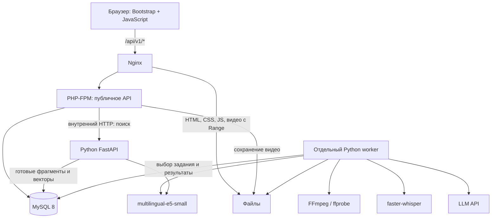

# Архитектура deepLecture: MVP для команды из трёх человек

Статус: архитектура MVP. Бэкенд реализован в ветке `backend`; фронтенд и
production-миграции БД остаются отдельными зонами работы команды.
Основание: ТЗ «Семантический поиск по видеолекциям», Киберрывок 2026.

## 1. Цель и границы первой версии

Полный сценарий: загрузка MP4/WebM → извлечение аудио → транскрибация
с таймкодами → семантический индекс → поиск → переход к моменту видео.
В MVP также входят синхронный текст, краткий конспект и оглавление с переходами.

В цель проекта также входят импорт YouTube/Vimeo и подготовка локального
Qwen2.5 3B для офлайн-режима. Импорт по ссылке пока **не реализован**;
его нельзя считать исключённым из требований или заменённым загрузкой файла.
Локальный LLM подключается через OpenAI-compatible API, см. `backend/LLM.md`.
Подготовка конфигурации не подтверждает inference и работу без интернета.

Вне текущей реализации: аккаунты, чат с лекцией и адаптивный видеостриминг.
Поиск пока ограничен одной выбранной лекцией.
Архитектура допускает последующее расширение поиска на весь курс.
Без аккаунтов MVP предназначен для закрытой демонстрации; публичный доступ
с загрузками потребует отдельного контроля доступа и лимитов.

## 2. Ответственность и владение файлами

| Участник | Зона ответственности | Каталоги, которые создаёт и меняет |
|---|---|---|
| Бэкенд — мы с ассистентом | PHP API, загрузки, Python/FastAPI, worker, FFmpeg, faster-whisper, E5, LLM, интеграция и конфигурация запуска | `backend/`, `infra/`, `tests/backend/` |
| Фронтенд | HTML/CSS/Bootstrap 5, JavaScript, плеер, статусы, поиск, транскрипт, конспект | `frontend/`, `tests/frontend/` |
| БД | DDL, миграции, индексы, связи и ограничения, тестовые данные и проверки схемы | `database/`, `tests/database/` |

Общие документы: `architecture/architecture.md`, `contracts/http-api.md`,
`contracts/database.md`. Бэкенд поддерживает контракты API; владелец БД
согласует контракт хранения. Изменение публичного поля сначала фиксируется
в контракте и сообщается двум другим участникам, затем реализуется.
Обычные изменения внутри своей зоны не требуют согласования всей команды.

Владелец БД не реализует PHP/Python-запросы и не запускает ML-модели.
Бэкенд не меняет миграции в обход владельца БД. Фронтенд не обращается
напрямую ни к MySQL, ни к FastAPI, ни к LLM.

## 3. Компоненты



Один origin для страницы, API и видео: фронтенду не требуется настройка CORS.
Внутренний FastAPI слушает только loopback/закрытую сеть. PHP-FPM не выполняет
долгие ML-операции. FastAPI не запускает транскрибацию в HTTP BackgroundTasks:
долговечные задания выполняет отдельный worker с очередью в MySQL.

## 4. Выбор технологий

| Задача | Решение MVP |
|---|---|
| Веб-интерфейс | HTML, CSS, Bootstrap 5, обычный JavaScript, Fetch API |
| Веб-API | PHP 8.3+, PDO MySQL, Composer; без обязательного нового фреймворка |
| Python | Python 3.11, FastAPI, Uvicorn, NumPy, sentence-transformers, faster-whisper, MySQL-драйвер |
| Хранилище | MySQL 8.0+, InnoDB, utf8mb4; видео и аудио на диске |
| Аудио | FFmpeg и ffprobe; mono PCM WAV 16 kHz |
| Распознавание | faster-whisper, начальная модель `small`, CPU `int8`; скорость и качество измеряются на демонстрационной лекции |
| Эмбеддинги | `intfloat/multilingual-e5-small`, 384 компонента, нормализованные float32 |
| Поиск | Точное скалярное произведение через NumPy по фрагментам выбранной лекции |
| Конспект | Адаптер к выбранному LLM API; модель и endpoint задаются конфигурацией |
| Локальный конспект | Ollama, `qwen2.5:3b`, тот же OpenAI-compatible адаптер, явный режим без ключа |
| Запуск | Nginx, PHP-FPM, MySQL, FastAPI, один worker; Docker Compose как целевой способ воспроизведения |

Точные версии пакетов и ревизии моделей закрепляются при реализации после
проверки совместимости. Docker Compose не является предпосылкой для написания
модулей: допустим нативный локальный запуск тех же процессов.
Redis, Celery и Qdrant для MVP не нужны. При росте коллекции векторный поиск
выносится за интерфейс `VectorSearch`; MySQL остаётся БД приложения.

## 5. Предлагаемая структура репозитория

```text
backend/
  php/
    public/index.php       # вход /api/v1/*
    src/Http/              # маршруты, валидация, JSON-ответы
    src/Service/           # загрузка, задания, вызов Python
    src/Repository/        # PDO, запросы согласно контракту БД
    composer.json
  python/
    app/api.py             # внутреннее API поиска и readiness
    app/worker.py          # очередь, lease, обработка и восстановление
    app/pipeline/          # audio, transcribe, chunk, embed, summarize
    app/repositories/      # SQL-доступ
    app/providers/         # LLM-адаптер
    requirements.txt
frontend/
  public/                  # index.html, assets/css, assets/js
  mocks/                   # примеры из HTTP-контракта
database/
  migrations/              # нумерованные SQL-файлы
  seeds/                   # фикстуры без реальных персональных данных
  README.md                # создание БД, применение/проверка миграций
contracts/
  http-api.md
  database.md
architecture/architecture.md
infra/                     # nginx, compose, конфигурация запуска
tests/                     # backend/, frontend/, database/
storage/                   # runtime, вне Git: videos/, audio/, model-cache/
```

Эта структура — план, а не перечень уже существующих программ.
Файлы `.env`, секреты, видео, аудио, веса моделей и runtime-выводы в Git не входят.

## 6. Поток обработки

1. PHP проверяет размер, расширение и MIME, сохраняет видео под случайным UUID.
   Исходное имя служит только метаданными. Путь нельзя передать из браузера.
2. В транзакции PHP создаёт `lectures` и `processing_jobs`; при ошибке БД
   удаляет только что загруженный файл. Идентификатор задания возвращается сразу.
3. Worker забирает задание с блокировкой строки и начинает извлечение аудио.
   ffprobe проверяет реальный контейнер, потоки и длительность; расширение
   само по себе не подтверждает корректность видео.
4. faster-whisper возвращает короткие сегменты текста с началом и концом.
   Они используются для транскрипта, субтитров и навигации.
5. Worker объединяет сегменты в поисковые chunks: ориентир до 384 токенов
   модели, перекрытие до 64 токенов, границы по сегментам, где возможно.
   Длинный сегмент делится с сохранением ссылки на исходный сегмент.
   Суммарная длина с префиксом не должна превышать лимит токенизатора модели.
6. E5 получает `passage: <текст>` для chunks и `query: <запрос>` для поиска.
   Все векторы нормализуются; модель, её ревизия и формат хранения совпадают.
7. После атомарной публикации индекса поиск доступен, пока строится конспект.
8. LLM обрабатывает длинную лекцию частями, затем объединяет результаты.
   Вход содержит ID сегментов. Для глав LLM возвращает ID начального сегмента,
   а не придуманный таймкод. Worker проверяет ID, сортирует главы и вычисляет
   время из транскрипта. Итог: обычный текст конспекта и список глав.
9. Worker публикует конспект и главы в одной транзакции и завершает задание.

Текст лекции считается данными: инструкции внутри него не должны менять
системные инструкции LLM. Ответ провайдера валидируется; в браузер не выводится
произвольный HTML, полученный из модели.

## 7. Состояния и отказоустойчивость

`queued → extracting → transcribing → indexing → summarizing → ready`.
Из любого выполняемого этапа возможен `failed`, с указанием `failed_stage`.
Отдельные признаки доступности выводятся из `*_ready_at`, а не из одного статуса:
поиск продолжает работать, если сломалась только генерация конспекта.

Worker фиксирует результат этапа транзакционно. Сетевые вызовы и ML-вычисления
не выполняются внутри долгой SQL-транзакции. Используются heartbeat и lease.
Схема захвата и защиты от устаревшего worker описана в контракте БД.
Повторная попытка MVP запускает всю обработку заново: генерируемые данные
сбрасываются атомарно, исходное видео сохраняется. Интерфейс предупреждает
о временной недоступности старых результатов до выполнения запроса повтора.

Для HTTP LLM задаются таймауты и ограниченные повторы при 429/5xx; при постоянной
ошибке этап становится `failed`. Конспект не подменяется шаблонным текстом.
Прогресс MVP — название этапа, без выдуманных процентов.

## 8. Конфигурация и ограничения

Настраиваемые параметры: DSN MySQL, учётные данные БД, путь storage, адрес
внутреннего Python API, имена/ревизии моделей, число CPU-потоков, LLM endpoint,
модель и credential binding. Секреты остаются на сервере и не попадают в JS.
Провайдер конспектов выбирается по доступности и поддержке русского языка;
до проверки доступа конспекты нельзя считать готовой функцией.

Начальный лимит загрузки: 500 MiB, длительность до 120 минут, один worker.
Это проектные ограничения MVP, а не требования ТЗ. Они должны совпадать
в Nginx, PHP и проверке ffprobe; время обработки проверяется на реальном железе.
Для демонстрации используется короткая лекция на 3–10 минут.
Число потоков моделей ограничивается, чтобы worker не блокировал веб-API.

Видео отдаёт Nginx с поддержкой Range и корректным Content-Type;
PHP не читает целую лекцию в память. Имена медиа генерируются сервером.
Доступ к storage с обходом путей и выполнение файлов из uploads запрещаются.
Распознанные секунды хранятся в миллисекундах; это не гарантия точности ASR:
попадание в речь проверяется отдельно.

## 9. Независимая работа и порядок интеграции

1. Все используют два контракта из `contracts/`, одинаковые имена полей и единицы.
2. Фронтенд сразу реализует экраны на mock-ответах из HTTP-контракта.
   Переключатель mock/API изолируется в одном модуле API-клиента.
3. Владелец БД создаёт миграции и фикстуры, проверяет FK, уникальность,
   откат транзакций и конкурентный захват задания.
4. Бэкенд параллельно реализует PHP-маршруты и Python pipeline по контрактам.
5. Первая интеграция: каталог → загрузка → queued → статус, ещё без ML.
6. Вторая: реальное видео → транскрипт → плеер и переходы по таймкоду.
7. Третья: реальный индекс → смысловой поиск → конспект и главы.

## 10. Критерии приёмки общей сборки

- MP4 и WebM загружаются; некорректный файл и превышение лимита дают понятную ошибку.
- Обработка не удерживает HTTP-запрос загрузки; статус обновляется после перезагрузки.
- После остановки worker задание восстанавливается по истечении lease.
- Транскрипт воспроизводит речь; клик и подсветка согласованы с плеером.
- Минимум пять заранее подобранных запросов-перефразирований проверены на
  релевантность и таймкоды; ожидаемые фрагменты записаны до прогона.
- На подготовленном индексе измерено время поиска; цель MVP — до 2 секунд
  на выбранной демонстрационной лекции после прогрева модели, не гарантия до замера.
- Конспект относится к содержимому, главы упорядочены и ведут к существующим сегментам.
- При недоступном LLM поиск сохраняется; интерфейс показывает отдельную ошибку конспекта.
- Повторная обработка не создаёт дубликаты сегментов, глав и поисковых результатов.
- Миграции воспроизводятся на пустой MySQL; изменения схемы не вносятся вручную.
- Инструкция запуска проверена другим участником без локальных секретов автора.

Сейчас эти критерии являются планом проверок, а не отчётом об их выполнении.
